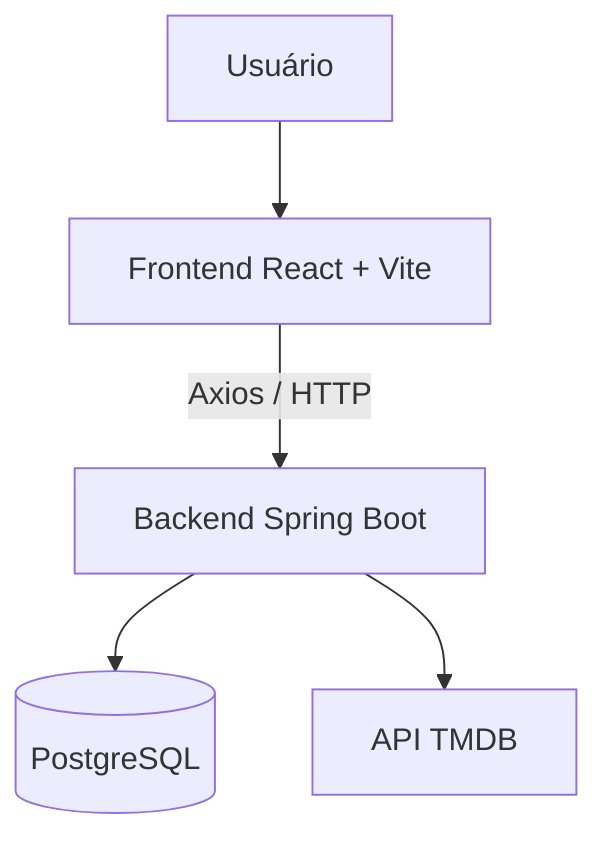

OurMovies — Frontend
Aplicação web desenvolvida em React e Vite para a coleção de filmes de um casal. Interface escura, responsiva e inspirada em plataformas de streaming, com pesquisa de filmes, favoritos, avaliações individuais e média das notas.

O frontend utiliza dados reais do backend Spring Boot, sem armazenar credenciais do TMDB ou acessar diretamente o banco PostgreSQL.
Funcionalidades
- Página inicial com destaques e indicadores da coleção.
- Pesquisa de filmes com debounce e paginação.
- Listas de assistidos, filmes para assistir e favoritos.
- Página de detalhes com sinopse, pôster, gêneros e avaliações.
- Criação, edição e exclusão de avaliações dos dois usuários.
- Exibição da média de notas do casal.
- Layout responsivo, skeletons de carregamento e tratamento de erros.
Tecnologias
- React e JavaScript (JSX) — interface e componentes.
- Vite — ambiente de desenvolvimento e build.
- React Router DOM — navegação.
- Axios — comunicação com a API.
- Lucide React — ícones.
- CSS — design e responsividade.
Arquitetura

O projeto está organizado em src/pages, src/components, src/hooks, src/services, src/utils e src/styles.
Iniciar
Requer Node.js 22.12+ e npm.
npm install
npm run dev
Abra http://localhost:5173.
Conectar ao Spring Boot
Mantenha o backend OurMovies em execução em http://localhost:8080, com o PostgreSQL e a chave TMDB configurados.

Durante o desenvolvimento, o proxy do Vite encaminha as requisições /api para o Spring Boot. Caso ocorra erro de conexão com localhost, configure o destino do proxy como http://127.0.0.1:8080.
Build
npm run build
Os arquivos de produção serão gerados na pasta dist/.
Observações
- Os dados de filmes, listas e avaliações vêm da API real, sem dados fictícios permanentes.
- O frontend não utiliza autenticação nesta versão.
- O backend já oferece endpoints de personalização dos perfis; a disponibilidade dessa interface depende da versão instalada do frontend.
- As credenciais do PostgreSQL e do TMDB não devem ser configuradas no React.
Projeto relacionado
Backend: OurFilms
Autor
Arthur Coelho — GitHub
