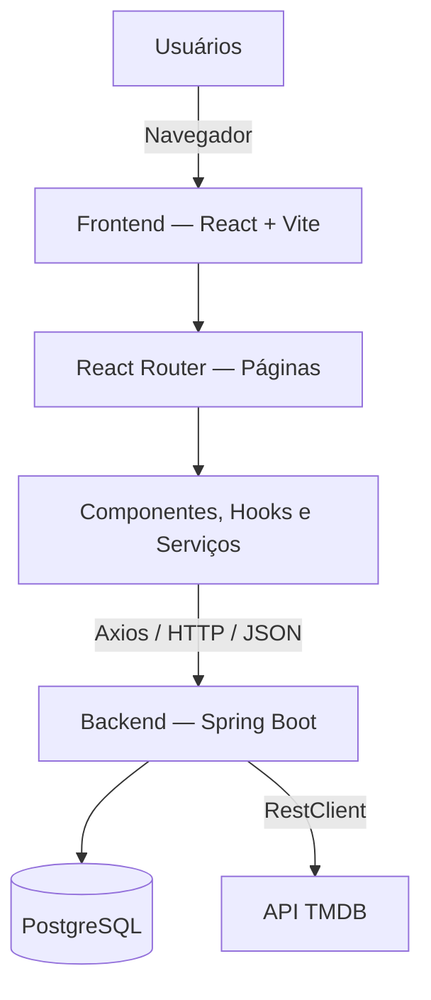

# OurMovies — Frontend

Interface web desenvolvida em **React e Vite** para organizar os filmes assistidos por um casal, criar uma lista de filmes para assistir, registrar avaliações individuais e visualizar a média das notas.

O projeto possui identidade visual inspirada em plataformas de streaming, com **tema escuro, destaques roxos, cards de filmes e layout responsivo**.

---

## Arquitetura do Sistema

O frontend é uma aplicação React que consome a API REST do **OurMovies Backend**. A integração com o catálogo TMDB e o acesso ao PostgreSQL são realizados pelo backend, sem expor credenciais ao navegador.



### Organização do Frontend

| Diretório | Responsabilidade |
|---|---|
| `src/pages` | Telas da aplicação |
| `src/components` | Elementos reutilizáveis da interface |
| `src/hooks` | Lógica compartilhada de componentes React |
| `src/services` | Comunicação HTTP com o backend |
| `src/utils` | Funções auxiliares |
| `src/styles` | Estilos globais e visuais |
| `src/App.jsx` | Composição principal da aplicação e navegação |
| `src/main.jsx` | Inicialização do React |

---

## Funcionalidades

- **Página inicial:** visão geral da coleção, destaques e indicadores.
- **Pesquisa de filmes:** consulta ao TMDB por meio do backend, com debounce e paginação.
- **Coleção:** navegação entre assistidos, filmes para assistir e favoritos.
- **Detalhes:** informações dos filmes e avaliações individuais.
- **Avaliações:** criação, edição e exclusão de notas e comentários.
- **Média do casal:** exibição da média calculada pela API.
- **Interface responsiva:** adaptação a diferentes tamanhos de tela.
- **Experiência de uso:** carregamentos skeleton, mensagens de erro e estados vazios.

**Personalização de perfis:** o backend já disponibiliza alteração de nomes e fotos; a integração dessa funcionalidade no frontend deve ser confirmada na versão atual antes de apresentá-la como concluída.

---

## Tecnologias Utilizadas

| Tecnologia | Aplicação |
|---|---|
| React | Construção da interface |
| JavaScript / JSX | Componentes e lógica da aplicação |
| Vite | Ambiente de desenvolvimento e build |
| React Router DOM | Navegação entre páginas |
| Axios | Comunicação com o backend |
| Lucide React | Ícones |
| CSS | Estilização e responsividade |

---

## Comunicação com o Backend

O frontend utiliza os endpoints REST da aplicação Spring Boot.

| Recurso | Operações |
|---|---|
| `/api/filmes` | Pesquisa e detalhes dos filmes |
| `/api/lista` | Listagem, inclusão, edição e exclusão da coleção |
| `/api/avaliacoes` | Registro, consulta e atualização das avaliações |
| `/api/usuarios` | Consulta dos perfis; personalização disponível na API |

### Fluxo de Funcionamento

1. O usuário pesquisa um filme na interface.
2. O React envia uma requisição ao backend por Axios.
3. O Spring Boot consulta o TMDB e devolve os resultados em JSON.
4. O usuário adiciona o filme à lista compartilhada.
5. O backend registra a operação no PostgreSQL.
6. A interface atualiza a coleção e apresenta as avaliações e a média do casal.

Os pôsteres são exibidos utilizando o caminho retornado pela API e o serviço público de imagens do TMDB.

---

## Como Executar

### Pré-requisitos

- Node.js e npm compatíveis com a versão do Vite instalada
- Backend OurMovies em execução em `http://localhost:8080`
- PostgreSQL configurado para o backend

### 1. Clone o repositório do frontend

Clone seu repositório de frontend no GitHub ou abra a pasta local do projeto no VS Code.

### 2. Instale as dependências

```bash
npm install
```

### 3. Inicie o backend

Certifique-se de que a API responde em:

```text
http://localhost:8080/api/usuarios
```

### 4. Inicie o frontend

```bash
npm run dev
```

Acesse:

```text
http://localhost:5173
```

No desenvolvimento, o proxy do Vite encaminha requisições `/api` ao backend na porta 8080. Se necessário, utilize `http://127.0.0.1:8080` como destino para evitar problemas de resolução IPv6 do `localhost`.

### Build de produção

```bash
npm run build
```

### Testes

Execute o comando de testes definido no `package.json` da versão instalada do projeto.

---

## Estrutura Visual

A interface segue o estilo de uma plataforma de streaming, combinando:

- Tema escuro com acentos roxos.
- Cards com pôster, título, gênero e informações essenciais.
- Navegação entre início, exploração e coleção.
- Visualização das notas individuais e média do casal.
- Feedback de carregamento, sucesso e erro.

---

## Projeto Relacionado

**Backend OurMovies:** [OurFilms — GitHub](https://github.com/arthurcoelho04/OurFilms)

O frontend depende da API Spring Boot para consultar e persistir informações. O banco PostgreSQL e a chave TMDB são configurados **somente no backend**.

---

## Autor

**Arthur Coelho**

[GitHub](https://github.com/arthurcoelho04)
