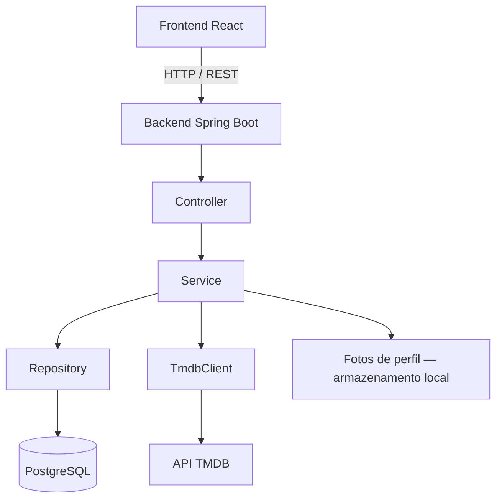

OurMovies — Backend
API REST desenvolvida em Java 21 e Spring Boot para gerenciar a coleção de filmes de um casal. Permite organizar filmes assistidos e pendentes, registrar avaliações individuais e calcular a média das notas.

A aplicação consulta a API TMDB para obter informações dos filmes e utiliza PostgreSQL para armazenar a coleção, os usuários e as avaliações.
Funcionalidades
- Pesquisa de filmes por nome e consulta de detalhes pelo TMDB.
- Lista compartilhada de filmes assistidos e filmes para assistir.
- Inclusão, atualização e remoção de filmes da coleção.
- Marcação de favoritos.
- Avaliações individuais com nota e comentário, além da média do casal.
- Personalização dos dois perfis: alteração de nome e foto.
- Validação de dados e tratamento centralizado de erros.
Tecnologias
- Java 21 e Spring Boot 4.1.2 — API REST.
- Spring Web MVC — endpoints HTTP.
- Spring Data JPA / Hibernate — persistência.
- PostgreSQL — banco de dados.
- Spring RestClient — integração com TMDB.
- Bean Validation e Lombok — validação e simplificação do código.
- Gradle — build e gerenciamento de dependências.
- JUnit, MockMvc e H2 — testes.
Arquitetura

O código é organizado em controller, service, repository, entity, dto, client, config e exception.
Iniciar
Requer Java 21, PostgreSQL e uma chave de API do TMDB.

Crie um banco PostgreSQL chamado ourmovies e configure as variáveis de ambiente no PowerShell:
$env:DB_PASSWORD = 'SUA_SENHA_POSTGRES'
$env:TMDB_API_KEY = 'SUA_CHAVE_TMDB'
As configurações padrão usam localhost:5432/ourmovies e o usuário postgres. Se necessário, ajuste DB_URL e DB_USERNAME. O diretório de fotos pode ser configurado por FOTOS_DIRETORIO (padrão ./data/fotos).

No mesmo terminal, inicie a API:
.\gradlew.bat bootRun
A API estará disponível em http://localhost:8080.
Endpoints
Recurso	Operações
/api/filmes	Pesquisar filmes e consultar detalhes
/api/lista	Listar, adicionar, atualizar e remover filmes
/api/avaliacoes	Criar, consultar, editar e excluir avaliações
/api/usuarios	Consultar perfis, alterar nomes e gerenciar fotos

Testes
.\gradlew.bat clean test bootJar
Os testes automatizados utilizam H2 e simulações do TMDB. A configuração com PostgreSQL e TMDB reais deve ser testada no ambiente de execução.
Observações
- A versão atual utiliza dois usuários predefinidos, sem autenticação JWT.
- A chave TMDB e as senhas pertencem apenas ao backend e não devem ser enviadas ao Git.
- As fotos são armazenadas localmente; o banco guarda somente suas referências.
Autor
Arthur Coelho — GitHub
